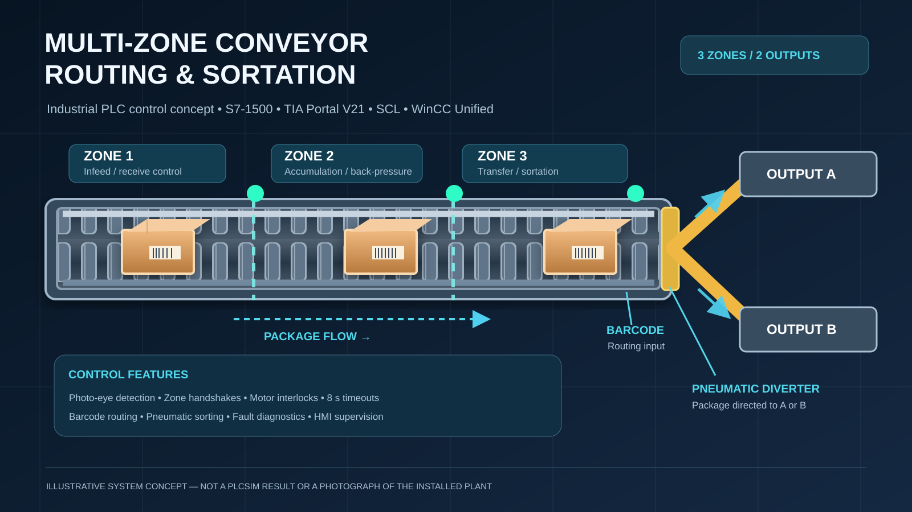
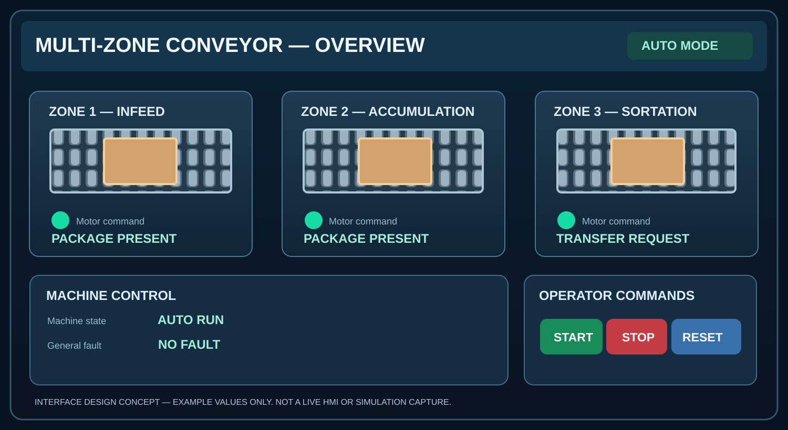
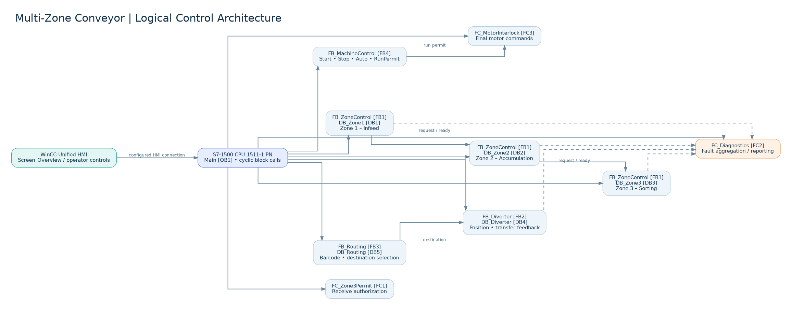
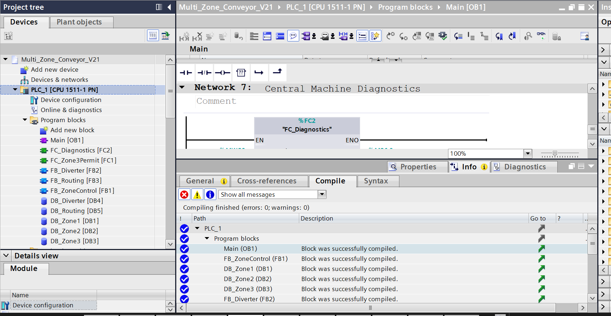

# Multi-Zone Conveyor Routing & Sortation

**Siemens S7-1500 | TIA Portal V21 | SCL | WinCC Unified | Industrial Automation**

A three-zone material-handling automation project with controlled package accumulation, zone-to-zone handshakes, barcode-based routing, a pneumatic sorting diverter, and central machine diagnostics. The control system was developed as a public, independently written reconstruction of conveyor-automation work from an Amazon RME internship.



> **Illustration:** A design visualization of the intended conveyor layout, not a real machine photograph or a recorded PLCSIM run.

## What the system does

1. **Zone 1 — Infeed.** Accepts a package request only when the receiving path is available. A photo-eye detects entry.
2. **Zone 2 — Accumulation.** Uses sensor feedback and downstream availability to prevent overfeeding and coordinate transfers.
3. **Zone 3 — Sortation.** Transfers packages into the routing area and coordinates with the diverter.
4. **Barcode routing and pneumatic diverter.** A simulated barcode input selects a destination and the diverter controls package redirection.
5. **Central supervision.** Machine Start/Stop/Reset, automatic mode, individual zone statuses, timeouts, fault codes, and interlocked motor commands.



> **HMI concept:** Example visual design and sample values. The actual WinCC Unified editor screen is linked below.

## Technology

| Area | Implementation |
|---|---|
| PLC | S7-1500 CPU 1511-1 PN (TIA Portal configuration) |
| Engineering | Siemens TIA Portal V21 / STEP 7 |
| Programming | SCL (Structured Control Language), FB/FC architecture and OB1 calls |
| Zone control | Three instances of `FB_ZoneControl` with separate instance DBs |
| Sorting | `FB_Routing`, `FB_Diverter` |
| Machine supervisor | `FB_MachineControl`, `FC_Diagnostics`, `FC_MotorInterlock`, `FC_Zone3Permit` |
| HMI | WinCC Unified PC RT, `Screen_Overview`, S7 communication |

## Software architecture



The modular control software organizes repeated zone logic into function blocks with individual instance data blocks. Every zone has the state transitions:

```text
EMPTY (0) -> LOADING (10) -> OCCUPIED (20)
                                       |
                                       v
                              TRANSFERRING (30)
                                       |
                                       v
                                   EMPTY (0)

FAULT (90) <- invalid sensor/state or timeout conditions
```

The zone implementation includes 8-second loading and transfer monitoring, downstream-sensor transfer confirmation, and diagnostic fault reasons. See [architecture and state transitions](docs/architecture.md).

## Browse the source code

- [FB_ZoneControl — SCL state-machine body](source/chat-reconstructed/FB_ZoneControl_V2_body.scl)
- [FB_Diverter — development draft](source/chat-reconstructed/FB_Diverter_V2_body_from_discussion.scl)
- [Source export guide](source/README.md)

The SCL files currently published are the available development text, not the full exported block interfaces. Remaining complete TIA Portal exports and the native `.zap21` project can be added from the author's local engineering project.

## Evidence from the engineering environment

These are real TIA Portal V21 **engineering/configuration screenshots**. They document the actual project work; they are not images of parcels moving through a simulated conveyor.

| PLC software | HMI / PLC communication |
|---|---|
|  |  |
| [Zone 1 FB call](media/screenshots/zone-block-call.png) | [WinCC Unified screen editor](media/screenshots/hmi-screen-editor.png) |
| [Watch table](media/screenshots/watch-table.png) | [HMI connection parameters](media/screenshots/hmi-connection-settings.png) |

## Documentation

- [Signal map and tags](docs/io-and-tags.csv)
- [Architecture details](docs/architecture.md)
- [Functional test scenarios](docs/test-plan.md)
- [Project background](docs/project-background.md)
- [Opening and exporting the native project](PUBLISHING.md)

## Technical verification and scope

PLC program blocks and the WinCC Unified PC Runtime configuration were compiled offline in TIA Portal V21 without reported compilation errors. A complete PLCSIM test run is **not represented by the published material**; the illustrative visuals above should not be interpreted as simulation results. A compilation result alone does not establish functional correctness or safety.

This independently reconstructed public version contains no original Amazon PLC program, internal plant drawing, or proprietary plant-network information. The simulated `SYS_SafetyOK` input is not a safety function, and an HMI Stop command is not an emergency stop. Real equipment would require safety engineering and commissioning validation.

## Author

**Hikmat Ghathe** · B.Sc. Computer Engineering · Industrial Automation / SPS / Embedded C/C++

[GitHub profile](https://github.com/HikmatGhathe)
