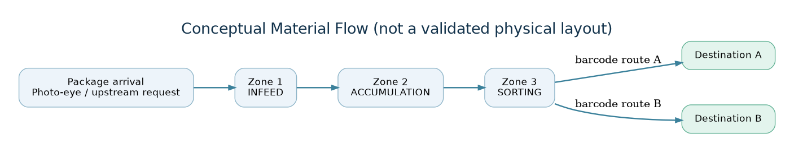
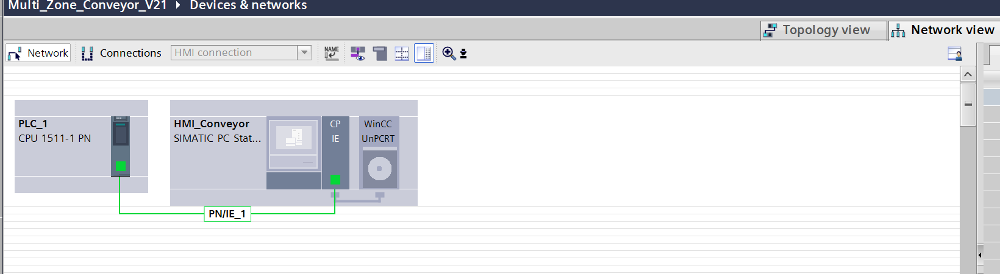
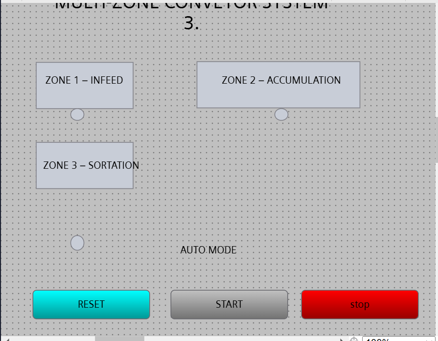
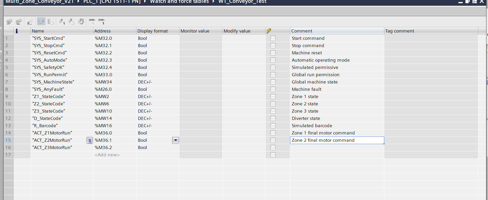

# Multi-Zone Conveyor Routing & Sortation — Siemens TIA Portal V21

**Industrial automation portfolio | Siemens S7-1500 • SCL/ST • WinCC Unified PC RT • Conveyor control • Fault diagnostics**

> **Project status (November 2026):** PLC logic and WinCC Unified HMI **compiled offline without errors** in TIA Portal V21. Full functional simulation/validation with S7-PLCSIM V21 is **not yet complete**, because download authorization was still pending. The provided `.scl` samples are bodies reconstructed from the development conversation, **not full exported TIA sources**.

## Project at a glance

A three-zone accumulation and sortation controller built as an independent reconstruction of conveyor-automation concepts practiced during an Amazon RME internship. The portfolio version models package arrival with photo-eye inputs, reusable SCL state machines, transfer handshakes, downstream back-pressure, barcode-based routing, a pneumatic diverting sequence and centralized diagnostics. A WinCC Unified PC Runtime HMI has been configured with a PLC connection, occupancy/motor indicators, machine-state text and operator controls.

| Item | Description |
|---|---|
| Engineering | Siemens TIA Portal V21 / STEP 7 Professional |
| PLC | S7-1500 CPU 1511-1 PN (configured) |
| PLC languages | SCL (Structured Control Language), LAD/OB1 block integration |
| Visualization | WinCC Unified PC RT / `Screen_Overview` |
| Architecture | `Main [OB1]`, reusable FBs + instance DBs, auxiliary FCs |
| Validation evidence | Offline compile screenshots; **no PLCSIM run yet** |
| Native project export | **To be added from the author's TIA installation** |

## Conveyor sequence

- **Zone 1 — Infeed:** accept an upstream package request when receive permission is present.
- **Zone 2 — Accumulation:** coordinate downstream availability and back-pressure.
- **Zone 3 — Sortation:** coordinate package transfer and the routing/diverter subsystem.
- **Barcode routing:** interpret simulated barcode input and select the intended destination.
- **Diverter:** command and verify a modeled pneumatic diverting position and exit sequence.
- **Machine supervision:** machine mode, RunPermit, centralized fault monitoring, motor interlocks and HMI commands.

### SCL zone-state model

`FB_ZoneControl [FB1]` uses these states in the **user-shared Version 2 source**:

`0 EMPTY → 10 LOADING → 20 OCCUPIED → 30 TRANSFERRING → 0 EMPTY`, with `90 FAULT` for invalid signals/timeouts.

The body includes TON-based loading/transfer timeouts, downstream-seen transfer confirmation and detailed fault codes. See [code](source/chat-reconstructed/FB_ZoneControl_V2_body.scl) and [architecture notes](docs/architecture.md).

## Implementation and screenshots

| PLC compilation | HMI network and connection |
|---|---|
|  |  |

| WinCC Unified editor (work in progress) | Watch table |
|---|---|
|  |  |

Additional screenshot: [WinCC PLC communication settings](media/screenshots/hmi-connection-settings.png) • [FB zone call](media/screenshots/zone-block-call.png)

## Code and native project

### Browse the PLC SCL code

- [`FB_ZoneControl_V2_body.scl`](source/chat-reconstructed/FB_ZoneControl_V2_body.scl) — full **body text** provided by the author in this conversation.
- [`FB_Diverter_V2_body_from_discussion.scl`](source/chat-reconstructed/FB_Diverter_V2_body_from_discussion.scl) — assistant-origin development draft; **not a verified export**.
- [`source/README.md`](source/README.md) — clear export checklist for all other blocks (Routing, Machine Control, diagnostics, permit, motor interlock, OB1).

### Open in Siemens TIA Portal V21

The native project archive (`.zap21`) has **not been supplied**. Once exported from the author's PC, it can be added under [`tia-portal-project/`](tia-portal-project/). GitHub shows readable `.scl` code and images in-browser, while the native archive requires TIA Portal to open.

## Technical documents

- [Architecture and state model](docs/architecture.md)
- [PLC signal map](docs/io-and-tags.csv)
- [Proposed functional test plan](docs/test-plan.md)
- [Amazon internship vs independent reconstruction](docs/project-background.md)
- [Source-code provenance](source/README.md)

## Scope and safety

This is a **portfolio/prototype** and must not be used for real conveyor control without electrical/pneumatic safety engineering, verified failsafe devices, drive and actuator interlocks, validated STOP/reset behavior and commissioning tests. `SYS_SafetyOK` is a simulated permissive, **not a certified safety function**. HMI STOP is **not** an emergency stop. The project is not an official Amazon implementation and includes no authorized Amazon source files.

## Author

**Hikmat Ghathe** — B.Sc. Computer Engineering, industrial automation and embedded software. [GitHub profile](https://github.com/HikmatGhathe).