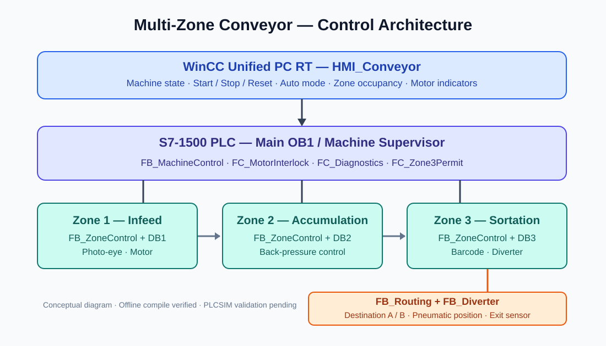

# Control architecture

## Components

| Layer | Component | Function |
|---|---|---|
| Cyclic PLC | Main OB1 | Calls reusable FBs and coordination FCs |
| Zone control | FB_ZoneControl (FB1) | Three separate instances for infeed, accumulation, sortation |
| Sorting | FB_Routing (FB3) | Simulated barcode classification |
| Pneumatics | FB_Diverter (FB2) | Diverter positioning and exit sequence |
| Supervisor | FB_MachineControl (FB4) | Machine mode and run permission |
| Auxiliary | FC_Zone3Permit (FC1), FC_Diagnostics (FC2), FC_MotorInterlock (FC3) | Handshakes, fault aggregation, output interlocks |
| HMI | HMI_RT_1 / WinCC Unified PC RT | Screen_Overview and HMI_Connection_1 |

## Zone controller (user-shared V2 SCL body)

| State | Meaning | Transition |
|---|---|---|
| 0 | EMPTY | Wait for receive permit and upstream request |
| 10 | LOADING | Run motor until photo-eye sees parcel, 8-second timeout |
| 20 | OCCUPIED | Wait for downstream ready and downstream sensor clear |
| 30 | TRANSFERRING | Track downstream photo-eye and upstream sensor clear, 8-second timeout |
| 90 | FAULT | Hold until reset conditions are met |

Fault reasons in the shared zone body: **10** loading timeout, **20** transfer timeout, **30** unexpected disappearance, **40** invalid state, **50** unexpected package without permit.

## Physical and safety boundaries

This is a simulation-oriented demonstration. The 2026 reconstruction was compiled offline, not validated against S7-PLCSIM or real drives. SYS_SafetyOK is a simulated permissive and not a safety-rated circuit; the HMI STOP is not an emergency stop. Reset and handshake sequences need functional review before commissioning.